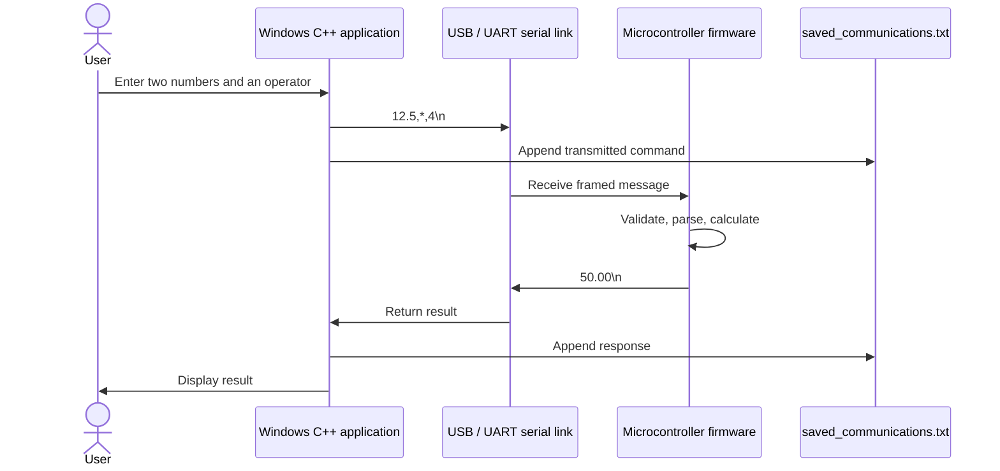

# PC–Microcontroller Serial Calculator

Two-part embedded system that sends arithmetic commands from a Windows C++ application to an Arduino-compatible microcontroller over UART and returns the calculated result.

## At a glance

| | |
|---|---|
| **Goal** | Demonstrate a complete PC-to-embedded-device communication workflow |
| **Host application** | C++17 with the Windows serial API |
| **Firmware** | Arduino C/C++ at 19,200 baud, 8-N-1 |
| **Protocol** | Newline-terminated `operand,operator,operand` messages |
| **Reliability features** | Input validation, serial timeouts, bounded reads, append-only communication log |

## Architecture



## Engineering highlights

- Defined a compact text protocol that is easy to inspect with a serial terminal.
- Separated host-side transport from embedded arithmetic processing.
- Added explicit handling for malformed messages, unsupported operators, and division by zero.
- Configured serial timeouts so a disconnected device does not block the host indefinitely.
- Protected the host receive buffer by reserving space for the C-string terminator.
- Preserved the original course artifacts while exposing readable source files directly in GitHub.

## Source code

- [`pc/serial_calculator.cpp`](pc/serial_calculator.cpp) — Windows host application. Pass the COM port as an optional argument; the default is `COM3`.
- [`firmware/serial_calculator/serial_calculator.ino`](firmware/serial_calculator/serial_calculator.ino) — Arduino-compatible firmware.

The original submitted ZIP archives remain in the repository for traceability, but the files above are the maintained, review-friendly versions.

## Message protocol

Requests use one line in this format:

```text
<first operand>,<operator>,<second operand>\n
```

Example:

```text
12.5,*,4
```

Successful responses contain the numeric result. Invalid requests return a human-readable `Error: ...` message.

## Build and run

### Firmware

1. Open `firmware/serial_calculator/serial_calculator.ino` in the Arduino IDE.
2. Select the connected board and port.
3. Upload the sketch.

### Windows host

Compile with a C++17-capable Windows compiler. With Microsoft Visual C++:

```powershell
cl /EHsc /std:c++17 pc\serial_calculator.cpp
```

Run with the default `COM3` port or provide another port:

```powershell
serial_calculator.exe COM5
```

Both sides must use **19,200 baud, 8 data bits, no parity, and one stop bit**.

## Documentation

The repository also contains the original design, visualization, development, compilation, and testing PDFs from the IU course *Programming with C/C++ (DLBROEPRS01_E), Task 1.2*.

## Scope

This is an educational embedded-communication project. It uses a simple text protocol without checksums, authentication, or retransmission and is not intended as a production industrial protocol.
